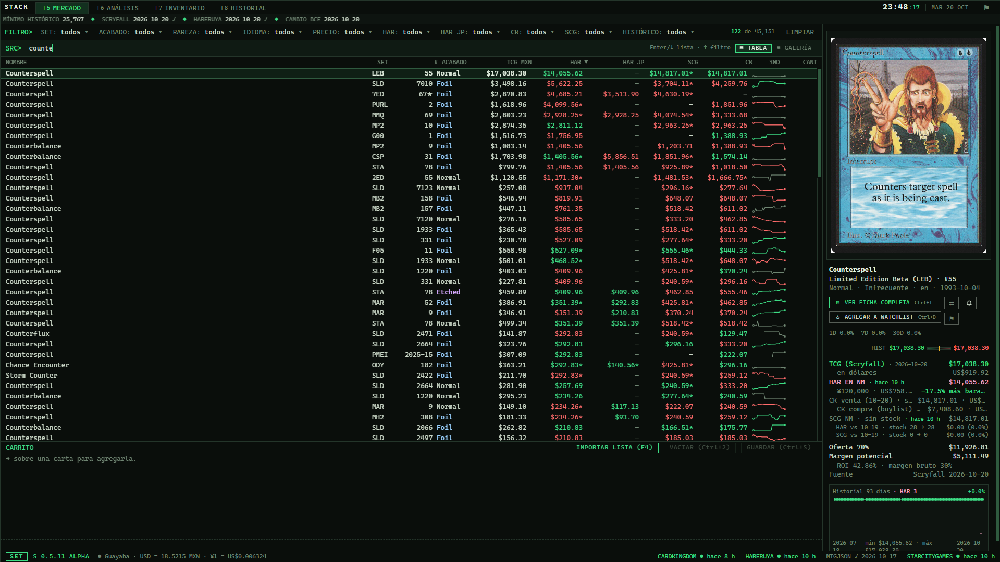

  

<h1 align="center">Stack</h1>

<b>Mercado MTG unificado</b> · precios de Magic: The Gathering de varias tiendas en una sola pantalla

  <a href="https://github.com/Guayaba7/stack/releases/latest"><b>⬇ Descargar la versión más reciente</b></a>

## Qué hace

- **Precios del día de TCGplayer (Scryfall), Hareruya, StarCityGames y Card Kingdom**, juntos y convertidos a pesos.
- **Más de 45 mil versiones** de cartas de $2 o más, con búsqueda instantánea y filtros por set, acabado, rareza, idioma y tienda.
- **Historial y gráficas** de cada versión: TCG, Hareruya, SCG, venta y buylist de Card Kingdom.
- **Análisis**: cartas que suben y bajan, entradas nuevas, arbitraje entre tiendas, movimiento de stock y mapa de calor por set.
- **Compras e inventarios** de la tienda, carrito, watchlist y alertas de precio.
- **Precios actualizados solos cada mañana**: no hay que descargar nada a mano.

## Instalar

1. Descarga **Stack-Setup-x.y.z.exe** de la [versión más reciente](https://github.com/Guayaba7/stack/releases/latest).
2. Ábrelo. Si Windows dice *"Windows protegió su PC"*: **Más información › Ejecutar de todas formas**.
3. Siguiente, Siguiente, Instalar. La primera vez Stack baja los precios del día (unos 50 MB).

Requiere Windows 10 u 11 (64 bits). No necesita permisos de administrador.

## Actualizar

Stack revisa al abrir si hay una versión nueva. Si la hay, aparece **↑** abajo a la izquierda: dos clics y se actualiza solo, sin perder compras, inventarios ni configuración.

---

Hecho por López. M para La Cofradía · versión beta

